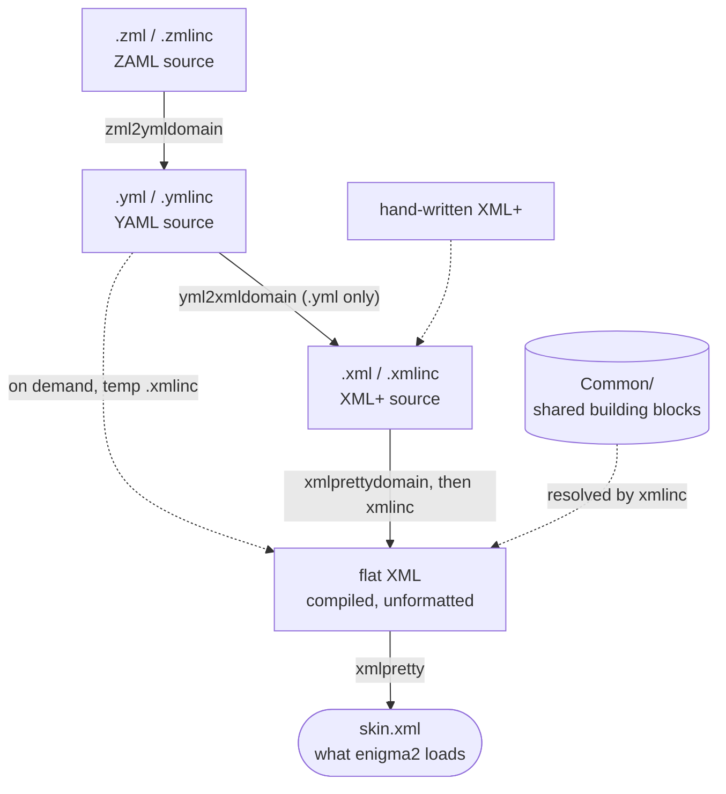

# SkinForge - Next generation Enigma2 skin design

SkinForge is a skin design kit that encompasses
- a hierarchical building block concept with
  - shared building blocks (buttons, title bars, lists, screen parts, ...) that live in one place and are reused by all your plugins
  - relative positioning of building blocks
  - global variables
- an offline skin compiler that lets you write skins in a richer, hierarchical language and compiles them down to the plain, flat XML enigma2 actually loads
- a 3-tier high level skin defintion language plus converters to translate it to/from XML

## Language levels

0. **XML**: the flat XML enigma2 itself understands; nothing to compile.
1. **XML+**: hierarchical XML with includes, variables, relative positioning and compile-time color/formula checking (`xmlcompile`).
2. **YAML**: a readable YAML dialect (`skin.yml` / `*.ymlinc`) that round-trips to and from XML+ (`ymlcompile`).
3. **ZAML** (Zenith Advanced Markup Language): YAML plus a `for`-loop for repeated blocks (`zmlcompile`).



## Quick start

Clone the repo and add the git dir to the PATH variable:

```
git clone git@github.com:OpenCockpit/SkinForge.git
```

Then compile a plugin's skin, where `<domain>` is the plugin's directory name:

```
zmlcompile <domain> [srcbase] [dstbase] [cmnbase]
```
## Wiki
- https://github.com/xcentaurix/SkinForge/wiki
